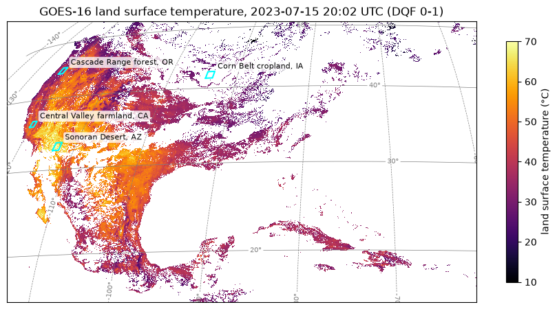
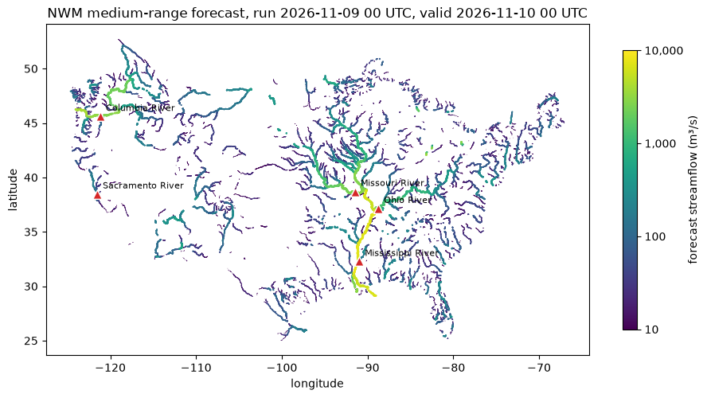
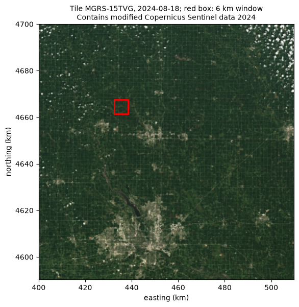

# ganymede: open HPC notebooks from Eugo

[](https://doi.org/10.5281/zenodo.24117548)

**ganymede is a public collection of Jupyter notebooks for high-performance and scientific Python:** three
case studies on public NOAA and Copernicus data, 44 Ray programs for parallel and distributed computing,
demos of popular data, geospatial and visualisation libraries, and smoke tests for 1,200+ Python packages and
240+ native libraries. The notebooks use ordinary pip-installable packages, so they run on a laptop or a
cluster, and everything is under the BSD 3-Clause license.

[Eugo](https://eugo.io) is building the performance cloud. We're making high performance computing the
default for every engineering team. The notebooks here run on any Python environment; none of them needs
Eugo.

**Website:** [eugo-inc.github.io/ganymede](https://eugo-inc.github.io/ganymede/) shows the case
studies, demo notebooks and Ray patterns rendered, with search and an [FAQ](https://eugo-inc.github.io/ganymede/faq/).

## Who it is for

- **Scientists and engineers working with Earth observation, weather and hydrology data in Python**: reading
  NetCDF, Zarr and Cloud-Optimized GeoTIFFs straight from public cloud buckets with xarray, rasterio and STAC.
- **Developers learning Ray by example**: Ray Core, Ray Data, Ray Serve, Ray Train and Ray Tune, each
  pattern shown as a graph next to its Ray code.
- **Platform and HPC teams**: a quick check that a Python package or a native library installs and works on
  a given machine.

## Case studies

Each case study reads public data anonymously (no cloud account), does the analysis on one file, then runs
the same per-file step over many files in parallel with [Ray](https://www.ray.io/).

<table>
<tr>
<td width="34%"><a href="demo_notebooks/case_studies/goes16_netcdf.ipynb"></a></td>
<td><b><a href="demo_notebooks/case_studies/goes16_netcdf.ipynb">Land surface temperature from GOES-16 NetCDF files</a></b><br>
Lists a day of hourly ABI Level 2 files in NOAA's public <code>noaa-goes16</code> bucket, applies the
product's quality flags, converts the satellite's fixed grid to latitude and longitude, maps the afternoon
skin temperature, and processes three days of files with Ray. xarray, s3fs, pyproj.</td>
</tr>
<tr>
<td><a href="demo_notebooks/case_studies/national_water_model.ipynb"></a></td>
<td><b><a href="demo_notebooks/case_studies/national_water_model.ipynb">Streamflow forecasts from the NOAA National Water Model</a></b><br>
Finds the newest complete 10-day forecast from the 00 UTC run in the public <code>noaa-nwm-pds</code> archive, maps forecast flow on the
larger rivers, follows five USGS gauges through the forecast, and reads more forecast hours with Ray. xarray,
Zarr, s3fs.</td>
</tr>
<tr>
<td><a href="demo_notebooks/case_studies/sentinel2_resampling.ipynb"></a></td>
<td><b><a href="demo_notebooks/case_studies/sentinel2_resampling.ipynb">Resampling Sentinel-2 imagery</a></b><br>
Searches a public STAC catalogue for Sentinel-2 Level-2A scenes, reads small windows of Cloud-Optimized
GeoTIFFs over HTTPS, compares resampling methods from 10 m to 60 m and from 20 m to 10 m, and computes a
cloud-masked NDVI for a whole growing season with Ray. pystac-client, rasterio.</td>
</tr>
</table>

## What is in the repository

| Folder | What is in it |
| --- | --- |
| [`demo_notebooks/case_studies/`](demo_notebooks/case_studies/) | The three case studies above. |
| [`ray_patterns/`](ray_patterns/) | 44 Ray programs drawn in Eugo's visual Ray builder: each notebook pairs a picture of the graph with the Ray code the builder generated for it, run on Ray 2.55.1 (three that need a GPU, a model-serving engine or a data catalog are shown as code only). Core (tasks, actors, object refs), Data, Serve, Train and Tune. |
| [`demo_notebooks/`](demo_notebooks/) | Short demos of popular Python libraries: data storage, geospatial, visualisation, data processing and more. Notebooks that draw plots or maps keep their figures. |
| [`package_tests/python/`](package_tests/python/) | One smoke-test notebook per Python package: import it and exercise its main API. Runs under pytest. |
| [`package_tests/native/`](package_tests/native/) | Declarative checks for native libraries (files present, shared-library dependencies resolve, static archives are position-independent, small test programs compile and run), with a standalone runner. |

## Quick start

```bash
git clone https://github.com/eugo-inc/ganymede.git
cd ganymede
python -m venv .venv && . .venv/bin/activate
```

**Ray patterns** — install Ray and open any notebook:

```bash
pip install "ray[default,data,serve,train,tune]==2.55.1" "protobuf<7" jupyterlab
jupyter lab ray_patterns/
```

Some patterns need extra libraries (for example `torch`, `lightgbm`, `xgboost` or `optuna`);
the *Extra packages* column in [ray_patterns/README.md](ray_patterns/README.md) lists what each
one needs. Keep `protobuf` below 7: Ray Serve 2.55.1 does not work with protobuf 7.

**Package tests** — install the runner and the package you want to test, then run its notebook:

```bash
pip install -r package_tests/python/requirements.txt numpy
pytest package_tests/python/numpy.ipynb
```

**Native checks** — point the runner at an install prefix:

```bash
python package_tests/native/run_native_checks.py --prefix /usr/local -k zlib_ng
```

**Demo notebooks** — notebooks that connect to a database or a cloud service read their
connection settings from environment variables; the *Environment variables* cell right after
the title lists them. See [demo_notebooks/README.md](demo_notebooks/README.md).

## Checks

```bash
python tools/check_notebooks.py
```

verifies that every notebook parses and carries no stray metadata, that `package_tests/`
notebooks and most demo notebooks are committed without outputs, and that the demo notebooks
listed in the script (the ones that draw plots or maps) keep only printed text, tables and static
images: no scripts, errors, `stderr` output, local paths or addresses.

## Contributing and security

See [CONTRIBUTING.md](CONTRIBUTING.md). Please report security issues privately as described in
[SECURITY.md](SECURITY.md).

## How to cite

GitHub's **Cite this repository** button (from [CITATION.cff](CITATION.cff)) gives APA and BibTeX
entries. The repository is archived on Zenodo: [doi:10.5281/zenodo.24117548](https://doi.org/10.5281/zenodo.24117548) covers all versions
and always resolves to the newest release, and release v2026.11.0 is
[doi:10.5281/zenodo.24117549](https://doi.org/10.5281/zenodo.24117549). To cite the exact files you used, cite the release DOI.
Please name the notebook you used and link the repository. In BibTeX, the double braces keep the
company name from being read as a person's name:

```bibtex
@software{ganymede_2026_11_0,
  author    = {{Eugo, Inc.}},
  title     = {{ganymede: open HPC notebooks from Eugo}},
  version   = {2026.11.0},
  year      = {2026},
  publisher = {Zenodo},
  doi       = {10.5281/zenodo.24117549},
  url       = {https://doi.org/10.5281/zenodo.24117549}
}
```

## License

Original content is licensed under the [BSD 3-Clause License](LICENSE), Copyright (c) 2026, Eugo, Inc.
Some examples are adapted from third-party projects and remain under their own licenses; see
[THIRD_PARTY_NOTICES.md](THIRD_PARTY_NOTICES.md).
